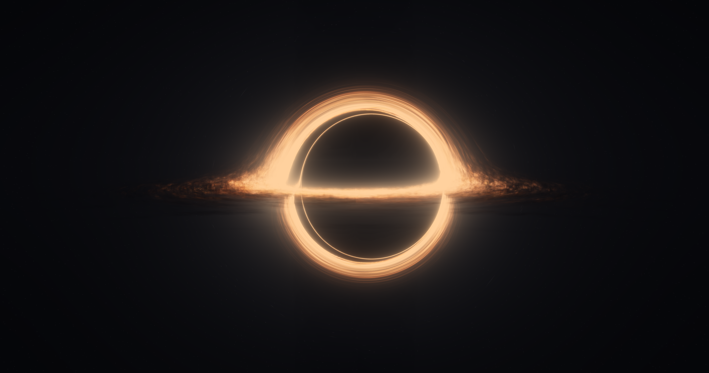

# kerr-schild-blackhole

A GPU ray-traced Kerr black hole rendered in **Kerr-Schild Cartesian coordinates** with [Taichi](https://www.taichi-lang.org/), in the visual style of *Interstellar*'s Gargantua — a volumetric accretion disc, gravitational lensing with multiple images, Doppler beaming, and a physically-motivated bloom + filmic pipeline.

> 用 Taichi GPU 光线追踪的克尔黑洞，采用 Kerr-Schild 笛卡尔坐标，《星际穿越》Gargantua 风格的体积吸积盘、引力透镜多重像、多普勒集束与 filmic 后处理。



## Highlights

- **Kerr-Schild Cartesian geodesics** — null geodesics integrated in an 8D phase space `(xᵘ, pᵤ)` using the Kerr-Schild form of the metric. Position is genuinely Cartesian `(x, y, z)` with the disc on the `z = 0` plane, avoiding the coordinate singularities of Boyer-Lindquist near the horizon.
- **Adaptive Dormand-Prince RK45** — per-ray adaptive step size with embedded error control; the integrator naturally produces **gravitational lensing and multiple images** (the bright top arc is a secondary image of the disc).
- **Volumetric accretion disc** — front-to-back alpha-composited gas disc built from iq 3D value noise, radial emission gradient, an inner self-glow core, and an optional organic dust-colour texture (aligned to the *lstSRS "Gargantua With HDR Bloom"* shader).
- **Relativistic Doppler beaming** (optional) — `gⁿ` frequency shift for prograde circular orbits, with an artistic `cos²θ` tilt control tied to camera inclination.
- **Jimenez / COD dual-filter bloom** — 13-tap downsample with a Karis-average firefly suppressor + 3×3 tent progressive upsample, then a two-stage exposure and filmic tonemap.
- **TAA supersampling** and a **sequence-frame animation** mode with automatic `ffmpeg` muxing to mp4.

## Requirements

- Python 3.8+
- `taichi`, `numpy`
- A GPU (CUDA / Vulkan / Metal — whatever your Taichi backend supports; `ti.init(arch=ti.gpu)`)
- `ffmpeg` on `PATH` — optional, only for auto-muxing animation frames into mp4

```bash
pip install taichi numpy
```

## Usage

Everything is configured in **`config.py`** — edit the parameters there, then run:

```bash
python main.py
```

Three mutually exclusive modes (set in `config.py`):

| Mode | Flags | Output |
|------|-------|--------|
| **Static frame** | `INTERACTIVE = False`, `ANIMATE = False` | a single image at `OUT_PATH` |
| **Animation** | `ANIMATE = True` | a frame sequence in `frames_ks/`, auto-muxed to `interstellar_ks.mp4` if `ANIM_AUTO_MERGE` |
| **Interactive** | `INTERACTIVE = True` | a live window (arrow keys / drag to orbit, `Ctrl`+wheel to zoom, `Space` pause, `R` reset, `P` screenshot) |

`INTERACTIVE` takes precedence over `ANIMATE`. For animation, drop the resolution/samples first (e.g. `1920×1080`, `SAMPLES = 2`) — 4K × many frames is slow.

The texture paths in `config.py` are anchored to the repo root via `_rel()`, so `assets/` is found regardless of your IDE's working directory.

## Module layout

| File | Responsibility |
|------|----------------|
| `config.py` | Taichi init, type aliases, **all tunable parameters** |
| `common.py` | shared Taichi helpers (`lerp`) |
| `fields.py` | global buffers, allocation (`build`), texture loading |
| `geodesic.py` | Kerr-Schild metric, Hamiltonian gradient, adaptive RK45, tetrad camera basis |
| `shading.py` | accretion-disc sampling, procedural starfield, Doppler shift |
| `render.py` | main render kernel (geodesic march + volumetric compositing + TAA) |
| `postprocess.py` | dual-filter bloom, two-stage exposure, filmic tonemap |
| `main.py` | entry point — static / animation / interactive drivers |

> Source comments are written in Simplified Chinese.

## Credits

- Accretion-disc look and bloom pipeline adapted from the **"Gargantua With HDR Bloom"** (lstSRS) Shadertoy shader by SonicEther.
- 3D value noise after **Inigo Quilez** (iq).
- Dual-filter bloom after **Jorge Jimenez**, *"Next Generation Post Processing in Call of Duty: Advanced Warfare."*

## License

MIT — see `LICENSE`.
